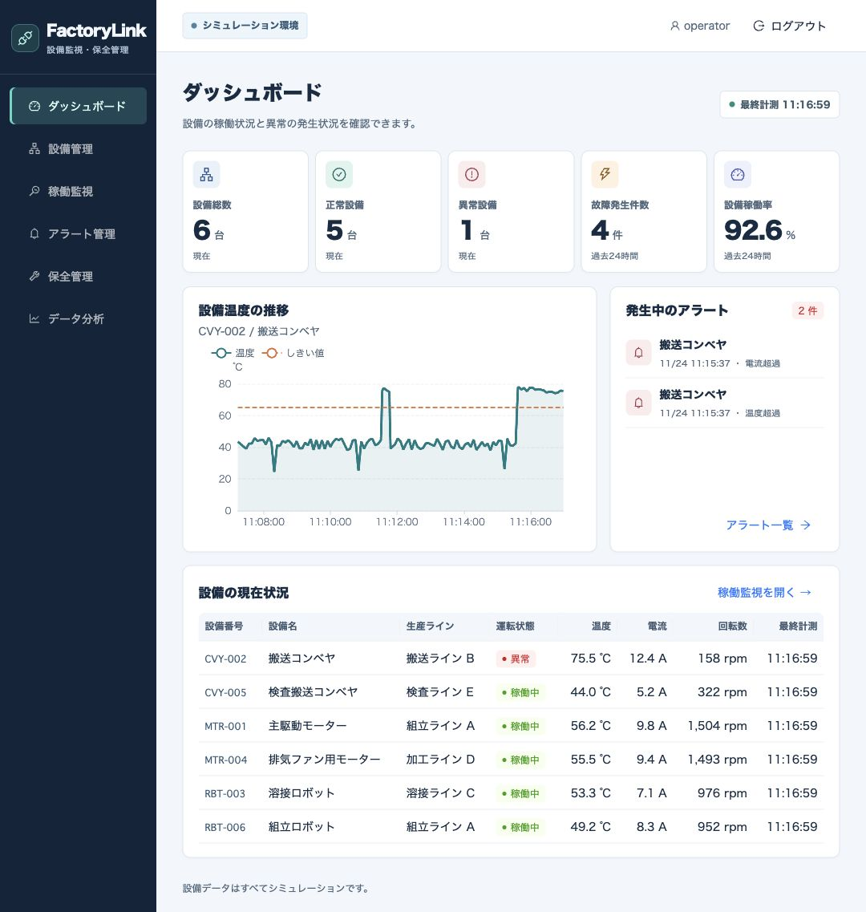
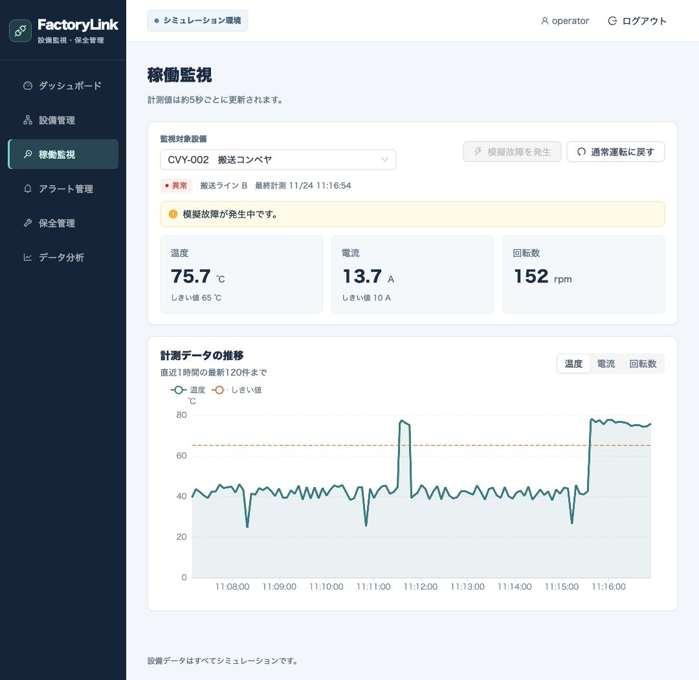
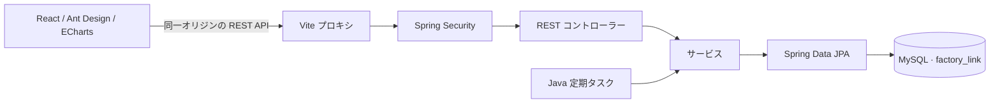

# FactoryLink

製造設備の稼働監視と保全作業を一元管理する、Java / React のフルスタックアプリケーションです。設備の登録から異常の検知、アラート確認、保全作業の完了までをひとつの環境で試せます。

> 画面で扱う温度・電流・回転数・稼働状態は、すべて Java で生成したシミュレーションデータです。

[日本語の技術資料](docs/architecture.md) · [REST API](docs/api.md) · [中文说明](README.zh-CN.md) · [中文学习指南](learning/guide.zh-CN.md)

## 画面

### ダッシュボード

設備台数、故障発生件数、稼働率、温度推移、発生中のアラートを表示します。



### 稼働監視

模擬故障を発生・解除し、温度・電流・回転数の変化を確認できます。



[ログイン画面の実行時キャプチャ](docs/images/login.jpg)

## 機能

| 機能 | 内容 |
| --- | --- |
| 認証 | Spring Security のセッション認証、BCrypt、CSRF 対策、ログアウト |
| 設備管理 | 設備情報と温度・電流しきい値の登録・編集・削除。設備番号・名称・生産ラインで検索 |
| 稼働監視 | Java による約5秒間隔の計測、REST API ポーリング、ECharts の履歴グラフ |
| アラート管理 | 指標ごとの異常検知、継続中の重複抑止、復旧、担当者による確認、履歴検索 |
| 保全管理 | 担当者の割り当て、故障原因と作業結果の記録、未対応 → 対応中 → 完了 |
| データ分析 | 設備台数、故障発生件数、サンプルに基づく稼働率、設備別温度履歴 |

## システム構成



**バックエンド** Java 21、Spring Boot 4.1、Spring Security、Spring Data JPA、Maven  
**フロントエンド** React 19、JavaScript、Vite 8、Axios、Ant Design 6、ECharts 6  
**データベース** MySQL。動作検証は macOS / Apple Silicon と MySQL 9.3 で実施しました。

## ローカル起動

Java 21、Maven、Node.js 24 LTS、MySQL サーバーとクライアントを用意します。VS Code や Navicat からソースやテーブルを確認できます。

1. MySQL を起動し、`localhost:3306` で接続できることを確認します。
2. リポジトリのルートで設定とデータベースを準備します。

   ```bash
   ./scripts/configure-env.sh
   ./scripts/init-db.sh
   ```

   初回の設定で MySQL のパスワードと、12文字以上・UTF-8 で72バイト以下のデモ用パスワードを入力します。設定はローカルの `.env` に保存されます。`init-db.sh` が作成するデータベースは `factory_link` です。

3. 1つ目のターミナルで API を起動します。

   ```bash
   ./scripts/start-backend.sh
   ```

4. 2つ目のターミナルで画面を起動します。

   ```bash
   ./scripts/start-frontend.sh
   ```

5. [http://127.0.0.1:5173](http://127.0.0.1:5173) にアクセスし、初期ユーザーID `operator` と手順2で設定したデモ用パスワードでログインします。初回のバックエンド起動時にアカウントと6台の模擬設備が作成されます。

既存アカウントのパスワードは再起動で上書きされません。追加のデモアカウントを用意するときは、ローカルの `.env` に新しい `DEMO_USERNAME` と `DEMO_PASSWORD` を設定して再起動します。

## デモの流れ

1. **稼働監視**で設備を選び、**模擬故障を発生**を押します。
2. **アラート管理**で、しきい値超過と発生日時を確認して **確認する** を押します。
3. **保全管理**で同じ設備の作業を登録します。担当者と原因を入力し、対応中へ進めます。
4. **稼働監視**で **通常運転に戻す** を押し、アラートの復旧日時を確認します。
5. 作業結果を入力して作業を完了し、**データ分析**で故障件数と温度履歴を参照します。

## 検証

```bash
./scripts/smoke-test.sh
mvn -f backend/pom.xml clean package
npm --prefix frontend ci
npm --prefix frontend run build
```

スモークテストは起動中の画面と同じ Vite プロキシを経由し、実際の MySQL に接続します。検証用設備を登録・削除し、検証用アラートと保全作業の履歴が残ります。対象フローと初版の仕様は [検証記録](docs/verification.md) を参照してください。
