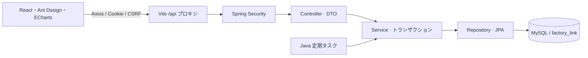
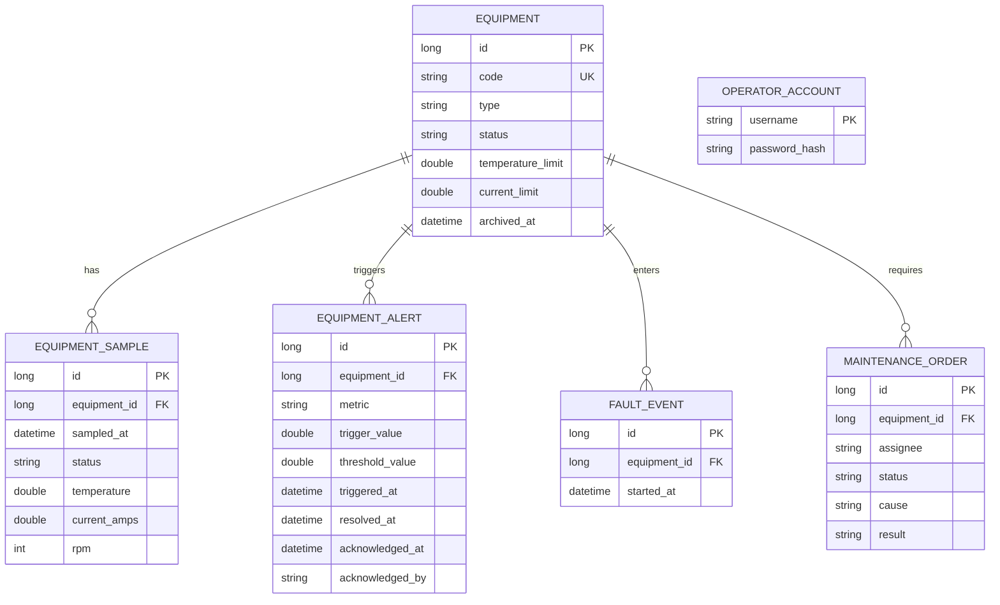
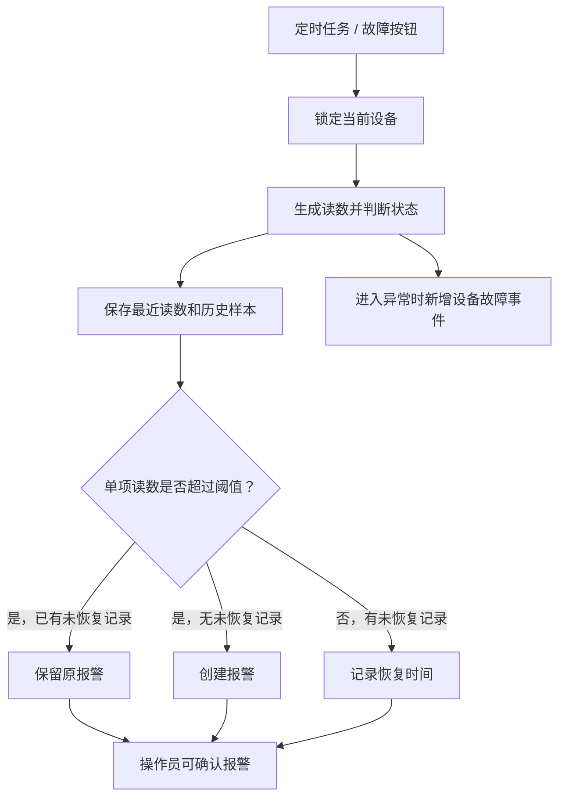
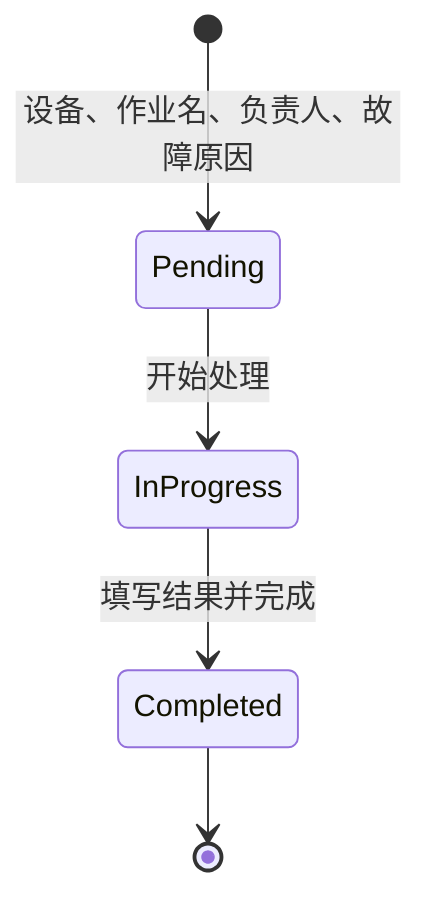

# システム設計 / 系统设计

## アーキテクチャ

浏览器请求相对路径 `/api`，Vite 将它转发到本机 Spring Boot。Controller 解析请求和校验 DTO，Service 执行业务规则，Repository 通过 JPA 读写 MySQL。数据库事务在 Service 层结束，响应中只包含显式声明的字段。

## ER 図

设备通过归档实现删除，设备编号继续保留。报警确认人记录登录用户名。工单的维修负责人是可输入的姓名字段，可分配给无需登录系统的人员。

## 計測・アラートの流れ

单台设备的读数、状态、样本、故障事件和报警在同一数据库事务内写入。温度和电流各维护一条持续中的报警。一台设备从正常或停止进入异常时，故障计数增加一次，即使两项指标同时超限。恢复以读数小于或等于阈值为条件，人工确认单独记录。

## 保全作業の流れ

